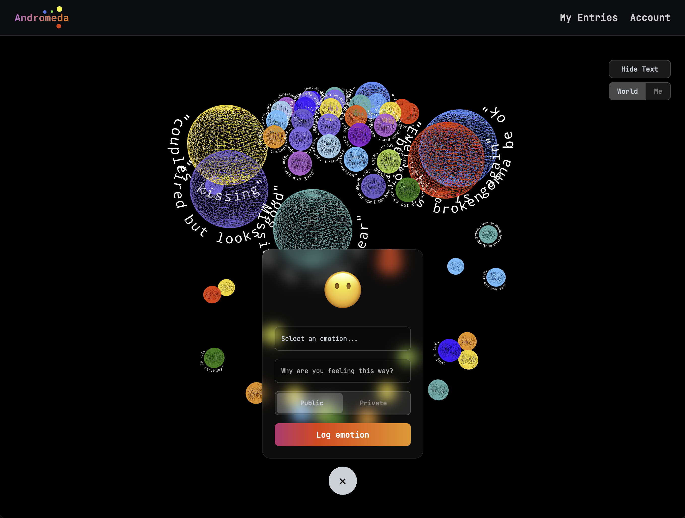

# Andromeda: Emotion Tracker and Visualiser


## What is Andromeda?
Traditional social media focuses on curated images and personal status updates, often leaving little room for genuine emotional expression. 

Andromeda is an anonymous, location-based emotional tracker and visualizer. It lets you drop digital "feelings" in public spaces—like leaving a note or street graffiti—for others to see. By turning emotions into interactive 3D objects, Andromeda creates a unique space for self-reflection and empathy.

## Features
1. **Emotion Tracking**: Users can log their emotions through a simple interface, selecting from a range of emotions represented by colours, emojis, and a short text description.
2. **Geo-Expression**: Emotions are tagged with geolocation data, allowing users to leave behind anonymous emotional markers in specific locations.
3. **Interactive 3D Visualisation**: Utilises **Three.js** to create a dynamic, evolving digital universe that visually represents the collective emotions of users over time. Emotions are mapped as interacting spheres with custom-rendered floating text.
4. **Adaptive UI (Light/Dark Mode)**: Automatically detects OS preferences to switch between a deep-space Dark Mode and a crisp Light Mode, instantly modifying both the CSS UI and the WebGL canvas.
5. **Premium Glassmorphism**: A fully bespoke, frosted-glass design language utilizing CSS `backdrop-filter`, tailored for a state-of-the-art aesthetic without relying on bulky CSS frameworks.
6. **Mobile-First Responsive Design**: Flawless experience across devices, bypassing traditional mobile-browser layout bugs (e.g., Safari's bottom bar) via robust viewport handling.

## Architecture
**The architecture follows a classic MEAN stack (Angular version) with a WebGL integration**:
- **Client Tier**: Angular SPA (Single Page Application) with Three.js
- **Server Tier**: Node.js/Express API
- **Database Tier**: MongoDB

```plaintext
+----------------+         +----------------+         +----------------+
|  Client (SPA)  | <-----> |  Server (API)  | <-----> |  Database (DB) |
|                |         |                |         |                |
| Angular 17+,   |         | Node.js,       |         | MongoDB        |
| Three.js, CSS3 |         | Express        |         |                |
+----------------+         +----------------+         +----------------+
```

## RESTful Routing
**Routes**:
- **GET /emotions**: Retrieve all emotional entries
- **POST /emotions**: Create a new emotional entry
- **PUT /emotions/:id**: Update an emotional entry
- **DELETE /emotions/:id**: Delete an emotional entry
- **GET /emotions/public**: Fetch all global public emotions

## Technologies
- **Frontend**: Angular, Three.js, Custom CSS (CSS Variables, Glassmorphism)
- **Backend**: Node.js, Express, MongoDB (Mongoose)
- **Authentication**: JWT (JSON Web Tokens) and bcrypt
- **Deployment**: Vercel (Frontend & Serverless API)

## Recent Refactoring Milestones
The project recently underwent a significant architectural and UI refactoring:
- **Migration away from Tailwind CSS**: Removed Tailwind in favor of a robust, custom design-token system utilizing CSS variables.
- **Glassmorphism UI**: Unified all cards, inputs, and modals under a modern frosted-glass aesthetic.
- **Automatic Theme Switching**: Engineered real-time toggling between Light and Dark modes. This applies to both the DOM (CSS variables) and the Three.js Canvas (material colors and sprites).
- **Mobile Safari Optimization**: Eliminated 100vh scrolling bugs and black-bar artifacts on iOS by refactoring the root layouts using `100dvh` and absolute positioning logic.

## Deployment Setup
The application is structured to be deployed easily on platforms like **Vercel**.

### Environment Variables
For the server, you will need to set:
- `MONGODB_URI`: Connection string to your MongoDB cluster
- `JWT_SECRET`: Secret key for signing auth tokens
- `PORT`: (Optional) If running locally outside serverless

## Future Development: Enabling a Social Aspect
To further enhance Andromeda and foster a sense of community among users, the following steps will be taken to implement a social aspect:

### Vision
Users' anonymised emotion data will contribute to a local shared digital sculpture, publicly available for viewing. This feature will function as an emotional "heat map" of their neighbourhood, allowing users to participate in and observe the collective emotional state of their community.

### Implementation Plan
- **Interactive Heat Map**: Develop an interactive 3D heat map utilizing WebXR and geolocation to display the collective emotional state of local areas.
- **Dynamic Scaling**: Adjust the size and intensity of visual elements based on the volume and intensity of emotional data over geographic radii.
- **Augmented Reality**: Integrate WebXR APIs to let users "see" floating emotion spheres through their phone camera in physical space.